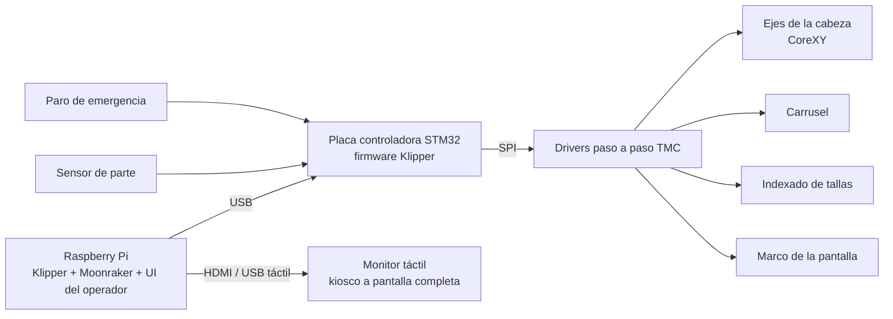

# Sistema de control de una máquina de serigrafía automática

**Español** · [English](README.md)

Software y electrónica de control de una máquina industrial de serigrafía automática: cabeza de impresión CoreXY de varios ejes, carrusel indexador e interfaz táctil para el operador, todo gobernado por una sola Raspberry Pi con **Klipper**.

Fue trabajo profesional para un fabricante de equipo industrial. El código fuente es propietario y no se publica aquí; esta página describe la arquitectura y los problemas de ingeniería resueltos.

## Demostración

https://github.com/user-attachments/assets/7a46d45f-330c-47ba-b7eb-85e7516d1419

## Qué construí

- **Control de movimiento** con Klipper para una cabeza CoreXY y ejes independientes para el carrusel, el indexado de tallas y el marco de la pantalla, con drivers paso a paso por SPI.
- **Home sensorless** (StallGuard de los TMC) en varios ejes, calibrado por eje y por velocidad de home.
- **El ciclo de impresión completo como macros de Klipper** (G-code + Jinja2): embarre, bajada coordinada, pasada de impresión, subida y avance del carrusel, con detección de prenda para saltar las estaciones vacías.
- **Una interfaz táctil propia** para el operador: HTML/JavaScript de una sola página que habla con Moonraker por WebSocket (JSON-RPC), bilingüe y en modo kiosco a pantalla completa.
- **Lógica de seguridad en software**: home obligatorio antes de cualquier ciclo, un modo manual con guardas y un paro de emergencia que apaga el firmware de inmediato.
- **Validación automática de macros**: un banco de pruebas en Python que renderiza cada macro con Jinja2 como lo hace Klipper, para detectar errores antes de desplegar en la máquina.

## Arquitectura

## Notas de ingeniería

Problemas que tuve que resolver y lo que me enseñaron:

- **La calibración de StallGuard depende de la velocidad.** Un umbral que hace un home fiable a una velocidad falla a otra, así que cada eje se calibra por bisección a su velocidad y aceleración reales de home, y las macros de home fijan esos valores explícitamente.
- **Sensores asíncronos dentro de Klipper.** Los eventos de `gcode_button` se encolan hasta que termina la macro en curso. Por eso el bucle del carrusel es un ciclo de dos pasos, uno para mover y otro para leer la bandera del sensor, y así nunca se pierde una detección.
- **Límites del perfil de movimiento.** En movimientos cortos el perfil de velocidad es triangular y nunca se alcanza la velocidad pedida; la velocidad pico queda limitada por √(aceleración × distancia). La aceleración se sube de forma gradual, verificando con la repetibilidad del home que no se pierdan pasos.
- **Orden de carga de la configuración.** Los pines de endstop virtual que exponen los drivers TMC deben registrarse antes que el motor que los usa, lo que define el orden de las secciones del archivo.
- **Estado seguro al liberar los motores.** Los comandos de liberación de motores se interceptan: cualquier liberación aborta el ciclo en curso e invalida todos los homes, obligando a hacer home de nuevo antes de producir.
- **Una única fuente de verdad.** El modo manual y el automático leen los mismos parámetros guardados, así que un cambio de ajustes se aplica a ambos y nunca se comportan distinto.
- **Pruebas sin la máquina.** Renderizar cada macro aislada con un estado simulado detecta errores de sintaxis y movimientos invertidos antes de que lleguen al hardware, aunque no sustituye la prueba en la máquina real.

## Tecnologías

Klipper · Moonraker · Raspberry Pi OS · STM32 · drivers paso a paso TMC · macros G-code / Jinja2 · HTML / CSS / JavaScript · WebSocket JSON-RPC · Python · systemd · nginx · Git

## Licencia

© 2026 Erwin. Todos los derechos reservados. Esta página se publica como muestra de portafolio; no se autoriza el uso, la copia ni la redistribución de su contenido.
